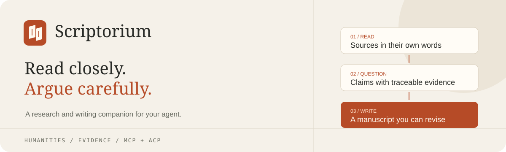

<p align="center"></p>

<p align="center">
  <a href="https://github.com/si126048/scriptorium-agent/actions/workflows/ci.yml"></a>
  
  
  <a href="LICENSE"></a>
</p>

<h3 align="center">把阅读、论证与论文写作，带进你正在使用的 Agent。</h3>
<p align="center">人文研究工具 · MCP 原生工具调用 · ACP 上下文适配 · 本地证据与文稿</p>

<p align="center"><a href="#快速开始">快速开始</a> · <a href="docs/writing.md">论文写作</a> · <a href="docs/plugin-integration.md">宿主接入</a> · <a href="docs/migration.md">从旧版迁移</a></p>

---

Scriptorium 是供 coding Agent 使用的学术研究插件。宿主模型负责理解与撰写，插件提供材料检索、精确引文、方法约束和可持续修订的论文文稿。你可以在同一段对话里，从研读原文走到分章节论文，再导出带脚注的 Markdown。

**3.6 已转向纯插件。** 当前代码不再包含独立前端、桌面安装器或常驻研究服务。首次使用资料库为空，由使用者主动导入；不附带用户题目、推荐书目、示例论文或密钥。

## 从材料到论文

| 阅读 | 论证 | 写作 |
| :--- | :--- | :--- |
| 导入自己选定的原文或节选 | 明确研究问题、主张与自身尺度 | 创建文稿、分章节保存正文 |
| 检索全文中部，逐窗口阅读 | 区分证据、推论、反例与限制 | 核验引文、保留修订与恢复 |
| 书目与实际正文分开记录 | 构境、内在批判、视差按需使用 | 固定版本导出 Markdown 与证据记录 |

这是一条实际的写作路径：`manuscript_create → manuscript_write_section → manuscript_read / restore → manuscript_export`。论文正文由宿主模型生成后交给工具保存；修改必须携带当前修订号，避免覆盖另一轮编辑。

### 方法有边界，论证有依据

- **构境**：文本位置、问题关系、概念配置、话语来源、实践条件与阅读者位置；允许竞争性解释。
- **内在批判**：先确定立场自身尺度，再区分事实错误、经验反例、外部批评与内在困难；无有效困难时可以停止。
- **视差**：先排除术语、事实与时期差异，再讨论位置变动和对象位移，保留反驳条件。

方法契约交给宿主执行，`research_prepare` 明确返回“等待宿主推理”。引用精确匹配只说明可定位，不自动证明观点成立。

## 快速开始

需要 Python 3.12+ 和 Git。建议使用专用虚拟环境。

```sh
python -m venv .venv
# Windows PowerShell
.venv\Scripts\Activate.ps1
# macOS / Linux: source .venv/bin/activate
python -m pip install "git+https://github.com/si126048/scriptorium-agent.git"
python -m scriptorium doctor
```

生成当前机器的配置片段，然后合并到宿主配置。`--workspace` 指向已经存在的研究目录。

```sh
python -m scriptorium config --host codex --workspace "D:/Research/my-paper"
```

支持的 `--host`：`codex`、`cursor`、`claude`、`qoder`、`vscode`、`zed`、`dsh`。生成器会使用当前 Python 的绝对路径；需要换解释器时添加 `--python`。静态模板位于 [integrations](integrations)。

MCP 通用配置形状如下，路径须替换为本机实际位置：

```json
{
  "mcpServers": {
    "scriptorium": {
      "command": "/ABSOLUTE/PATH/TO/python",
      "args": ["-m", "scriptorium.plugin", "mcp", "--workspace", "/ABSOLUTE/PATH/TO/RESEARCH"]
    }
  }
}
```

插件不需要第二份模型密钥，也不启动 PostgreSQL、Elasticsearch、Web 或桌面程序。宿主启动 stdio 子进程，输出通道只用于协议。

## 让 Agent 开始写作

把原文放进研究目录后，可以对宿主说：

> 用 Scriptorium 导入我选定的材料，先明确研究问题并检索证据。围绕这些材料写一篇论文：给出摘要、引言、分节论证、反方意见与结论。不要只停在提纲；用文稿工具保存完整章节，引用必须绑定可定位原文。缺失材料和待核实书目明确列出，最后导出 Markdown。

正文使用 `[[cite:1]]` 等标记绑定实际来源，保存时核验，导出时转成脚注。重复引文必须提供位置；只有书目、未读原文或不存在的引文不能作为正文证据通过保存。[完整工具流程与参数](docs/writing.md)

## 工具一览

| 工具 | 用途 |
| :--- | :--- |
| `research_status` | 当前工作区、材料数量、已存文稿与执行边界 |
| `source_import` / `sources_list` | 主动导入与查看不可变材料 |
| `source_search` / `source_read` | 全文检索、按 Unicode code point 读取窗口 |
| `quote_verify` | 精确摘录、重复消歧与内容散列核验 |
| `research_prepare` | 研究方法、写作契约和已覆盖／未覆盖材料 |
| `manuscript_create` | 创建空白、可修订文稿 |
| `manuscript_write_section` | 保存章节、核验引文与修订冲突 |
| `manuscript_read` / `manuscript_restore_section` | 读取章节、查看历史、恢复为新修订 |
| `manuscript_export` | 固定修订的 Markdown、脚注和证据追踪 |

## 兼容与实际边界

| 接入 | 当前状态 |
| :--- | :--- |
| **MCP stdio** | 主要写作入口；真实 SDK 子进程调用验证 |
| **Codex / Cursor / Claude Code / Qoder / VS Code** | 提供对应配置；宿主原生加载须在各产品中验证 |
| **DeepSeek Harness** | 通过官方 `@deepseek-ai/dsh-mcp-client` 桥接；已提供配置，原生宿主未实测 |
| **ACP v1 / Zed** | 上下文 Agent 子集与协议验证；不自带推理模型，不宣称独立完成论文 |

当前支持 UTF-8 TXT、Markdown、主动提供的文本、节选及书目。PDF/OCR、联网发现和 DOCX 转换由宿主已授权工具处理，再导入文本；插件不会自动抓取网络。书目、URI、作者和页码均为使用者提供的元数据，不冒充独立核验。

论文导出是**可编辑待审稿**：专业格式、作者归属、观点支持关系和目标期刊要求仍需复核。当前没有“自动投稿质量认证”，也不捏造读过的文献或个人经历。

## 数据与开发

材料、正文和历史修订保存在研究目录下的 `.scriptorium/research.sqlite3`。该目录默认忽略，不随包分发。插件不扫描整个仓库，不读取旧桌面数据库；工作区隔离，路径越界被拒绝。备份时先停止该工作区的插件进程，再复制整个 `.scriptorium` 目录（包括存在的 WAL 文件）。

```sh
python -m pip install -e ".[dev,build]"
ruff check scriptorium tests scripts
python -m pytest -q
python scripts/verify-plugin.py
python scripts/build-plugin.py
```

默认检查只使用临时合成材料，不调用付费模型。可选供应商验证需要显式 `--qwen`，密钥只从环境变量读取。[交付记录](docs/acceptance/plugin-3.6-20261027.md) · [剩余边界](docs/status/remaining-tasks.md)

## 许可与致谢

当前插件采用 [MIT](LICENSE)。历史改编来源与版权声明保留在 [NOTICE](NOTICE) 和 [LICENSE-MISAKA](LICENSE-MISAKA)；原工作台可从 Git 历史查阅。方法受张一兵构境、黑格尔内在批判与齐泽克视差启发，工具实现不等于对相关理论的最终解释。
