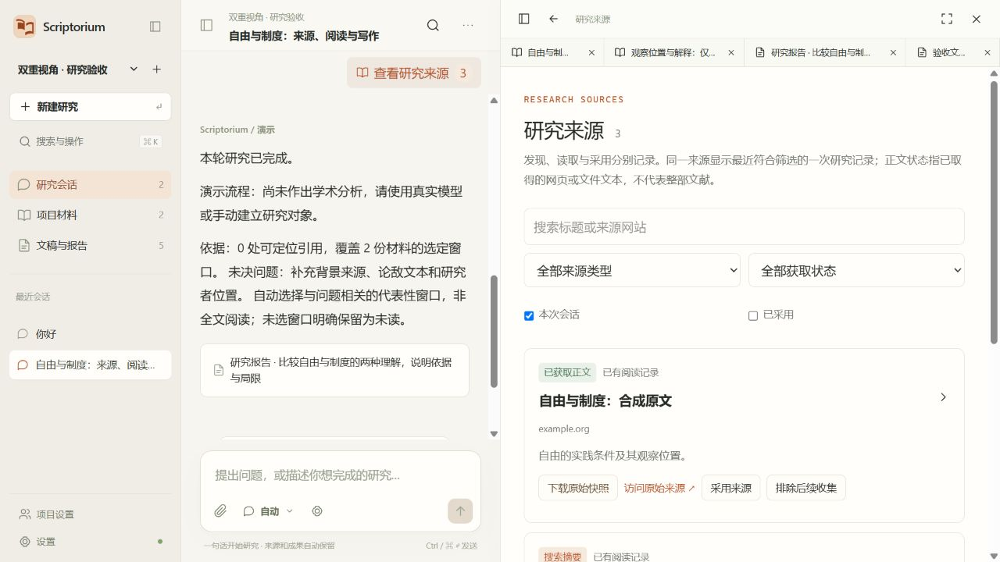
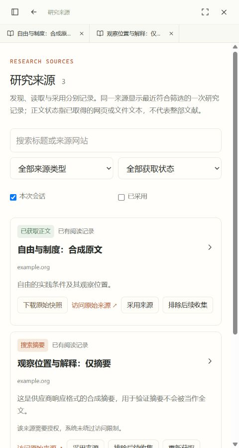
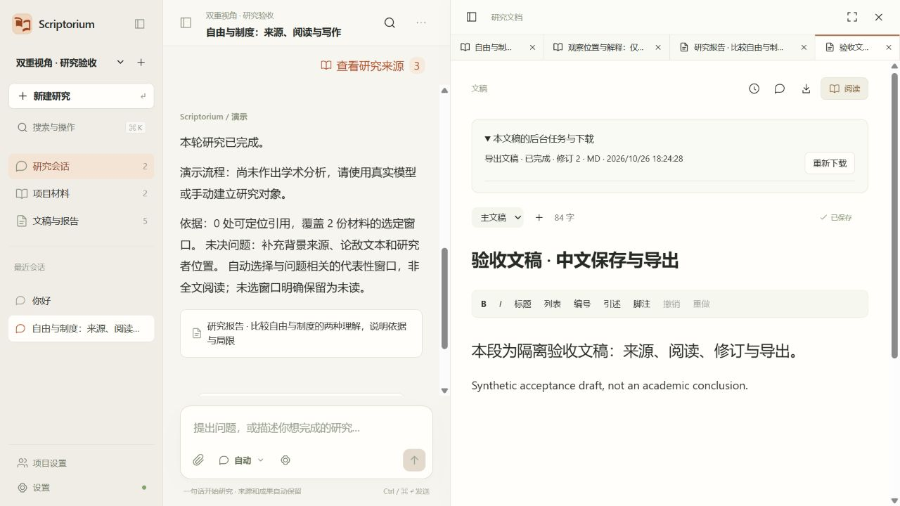

# Scriptorium 3.4.0 一句话研究与自动来源验收

验收日期：2026-10-25—26。本报告对应本机未提交工作树；Git 基线为 `5d1eaf9bd5163b41c96722b57e6629b2df3ef75a`。最终源文件摘要与候选散列见本报告末尾的交付证据，不以旧提交或历史 350 项记录代替本轮结果。

## 交付范围

默认输入改为自动：问候、操作帮助、本地材料研究和联网研究按请求分流。空项目的“你好”直接回复，不联网、不调用模型；明确指定材料或关闭联网时不扩大范围。旧 ask/chat/research 接口继续兼容。

Qwen 来源发现使用已明确支持的 DashScope 原生端点和模型，复用当前配置的密钥。能力声明表示协议适配，未验证真实账号或付费连接。空来源、结构错误、未知消耗和不支持的端点均进入明确恢复路径，不替换为演示成功。

来源立即登记到项目与会话，保存供应商来源编号、URL、时间、元数据及不可变响应快照。正文获取复用材料—版本—转录—TEI—锚点体系；摘要有独立材料及警示。原始网页通过下载提供，不在应用内执行。正文取得只表示取得该网页或文件文本，不表示整部著作已取得或读完。

持久收集检查点支持来源重用、已下载对象重用、取消及从检查点恢复。来源采用、阅读及报告使用分开记录。失败调用保留消耗；未知下载额度保留预留。默认上限为 3 次发现、20 个候选、10 个不同正文尝试、20 MiB/份、100 MiB 累计、4 万 token、6 节点、2 轮修订。

自动研究选取与问题相关的代表性窗口，保存未读覆盖；默认约 6000 Unicode code point，并非全文研究。报告采用当前有效论点与实际引用，旧解释保留于过程；摘要和网页文本不伪造原书页码。

前端新增来源库、收集进度与恢复决定、中文错误操作，保留三栏及文稿保存机制。研究报告默认阅读；转入文稿后默认编辑，恢复未保存草稿时保留编辑入口。来源搜索、类型、取得状态、会话及采用筛选使用服务端分页；重复来源以最近符合筛选的关联显示。查看原文后返回保留筛选；新来源不抢占已有文稿。

品牌改为原创错位书页与双重视角 SVG，同源生成 favicon、PNG、ICO 和桌面图标。工作台、启动页、设置与启动动画共用暖白橙色规范，成功状态使用绿色；启动动画约 1.5 秒、可跳过，保留安静及减少动态效果。旧样式按功能逐步收敛，没有整体重写全部旧 CSS。

## 主要文件

| 范围 | 实际文件 |
|---|---|
| 自动路由与检查点 | `scriptorium/research/automatic.py`、`workspace.py` |
| 原生联网与账本 | `native_search.py`、`calls.py`、`providers.py` |
| 公共下载及来源入库 | `public_fetch.py`、`collection.py`、`source_api.py` |
| 后续迁移及备份 | `schema_v6.py`、`migrations/research/versions/0006_discovery.py`、`backup.py`、`cli.py` |
| 来源与研究界面 | `SourceLibrary.tsx`、`TaskFailure.tsx`、`useSources.ts`、`UnifiedWorkspace.tsx` |
| 引用、事件及模型设置 | `SourceReader.tsx`、`useConversationEvents.ts`、`ModelProviderForm.tsx` |
| 设计与品牌 | `web/public/brand/`、`design-tokens.css`、`sources.css`、`src-tauri/icons/` |
| 操作与品牌说明 | [自动研究运行说明](../automatic-research-runbook.md)、[品牌与界面规范](../design/scriptorium-3.4-brand-and-interface.md) |

历史迁移没有改写，新增 `research_0006` 增加来源、研究关联、收集状态和联网调用记录。版本统一为 3.4.0，3.3.1 数据库就绪与 Rust 直接读取系统凭据的启动修复保留。README、tools、源 SQLite 与实际用户研究库未作正式切换。

## 必要检查

| 检查 | 结果与范围 |
|---|---|
| 定向 Python 回归 | 36 项通过：自动研究 16、集成工作台 9、稳定写作 5、启动等待 6；68.04 秒 |
| 前端单元 | 8 项通过：保存队列、Unicode 窗口、文档标签 |
| 前端类型、lint、生产构建 | 通过，最终静态文件与候选绑定 |
| Python lint、生成类型一致性 | 通过；旧 v1 重复 Operation ID 警告保留，不属于新来源接口 |
| Rust | 常规 2 项通过；实际 Windows 系统凭据读取检查另 1 项通过 |
| 隔离迁移 | 独立 PostgreSQL 17.6 数据库从 research_0005 升至 research_0006，原项目身份保留 |
| 备份恢复 | 定向集成检查通过，包含来源关联、快照和原件；未对用户实际库执行恢复 |
| 浏览器 | 隐藏验收页、合成材料：问候、来源、准确版本、摘要警示、筛选返回、键盘命令面板、安静模式、480px 无横向溢出、报告默认阅读、文稿中文编辑与刷新恢复、任务恢复后 MD 重新下载通过 |
| 候选包内执行 | 通过：3.4.0 API、Worker、TXT/Markdown 导入、自动问候、来源接口、原文读取、固定修订 DOCX 导出（10631 字节）、静态 JS、品牌及 favicon；模型调用 0 |
| 独立本机后台 | 通过：独立新集群、凭据与对象目录，复用已核验依赖，PostgreSQL 就绪—迁移—API—Worker—材料导入；检索明确关闭，未执行安装器、未注册登录启动 |

测试使用独立数据库、合成网页及模拟供应商。覆盖私网和重定向拦截、大小限制、来源去重、取消及恢复、未知额度、受限来源、原件对象访问隔离、撤回阻断、引用位置、保存与固定版本导出。保留的相关写作检查确认保存失败阻断依赖操作及固定修订导出，不重复运行无关全量回归。

浏览器证据中的示例来源为 example.org 合成材料；演示报告明确注明不构成学术结论，不能据此宣称 Qwen 真实联网或学术能力通过。

## 未执行与实际边界

- 按用户范围跳过：学术能力评分、专家评议、付费 Qwen 重跑、服务器部署、全量压测和安装矩阵。
- 真实 Qwen 连接及公开网站获取没有发起；官方地域/模型适配需在用户明确触发后检验。自定义端点和其他供应商联网未适配，不静默换服务。
- 登录/付费检测为有限页面特征识别；不能保证识别所有站点或排版。扫描件保留原件，完整 OCR 不属于本轮。
- 中文文本输入及保存可用；真实硬件输入法组合过程、完整无障碍审计未执行。
- 本轮没有重新执行真实 ES/S3 集成；原有检索路径保留，不能计为新增通过。
- 未运行 NSIS 安装器或桌面 GUI；不把直接候选后台检查等同于干净用户环境安装验收。
- 未提交、推送、发布、安装、正式迁移用户数据或删除旧库。历史日志和库保留。

## 交付证据

代码摘要（330 个构建源文件；不含文档、临时数据及构建产物）：`fa94da88f2169f548fa0fbb494e63741577a43717226f626e3e780e1deace496`。

Windows 当前用户 NSIS 候选：`src-tauri/target/release/bundle/nsis/Scriptorium Agent_3.4.0_x64-setup.exe`，130317428 字节（约 124.28 MiB）。SHA-256：`7a25834751a16020c4e68d4f81ffcc3c197d3c2bbfe03634e2aeef4ef580ffa1`。

包内已测试后端 SHA-256：`0efc5a72f1680ab329a7f470ae1b07c71230c02db939698d925d6436f08603b7`；从 NSIS 中解出后核对一致。桌面产品与文件版本均为 3.4.0。Tauri 在打包时写入 NSIS 类型元数据，包内桌面与未打包桌面只有 3 个字节差异，两者散列分别留存，不能混用。

[候选散列清单](evidence-20261026-auto34/auto34-candidate-hashes.json)、[代码摘要](evidence-20261026-auto34/auto34-source-digest.json)、[后端回归](evidence-20261026-auto34/auto34-final-regression.log)、[安装包构建](evidence-20261026-auto34/auto34-installer-build.log)、[包内检查](evidence-20261026-auto34/auto34-packaged-smoke.json)、[本机冷启动](evidence-20261026-auto34/auto34-native-check.json)、[浏览器检查](evidence-20261026-auto34/browser-checks.json)。

导出复核最初因独立开发预览未指定缓存而等待 Pandoc 下载；指定已验证缓存并恢复 Worker 后，原任务以修订 2 完成且可重新下载，未创建第二份正式导出。开发预览经历中断后继续恢复；最终安装候选仅生成一次成功产物。

结论：本轮工程修缮及 Windows 候选构建完成；真实供应商连接、完整安装流程和其余未验证项保持上述明确边界。

