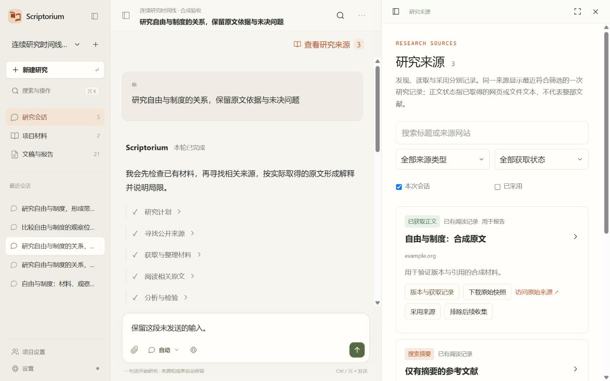
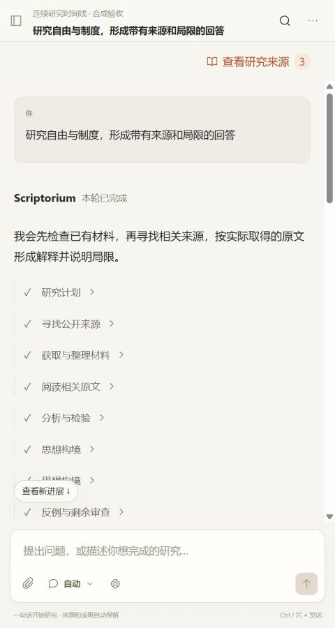

# Scriptorium 3.5.0 连续时间线与材料获取验收

日期：2026-10-26。基线 Git HEAD：5d1eaf9bd5163b41c96722b57e6629b2df3ef75a；本轮仍为未提交工作树。实际构建输入与候选散列单独留存，历史 3.4 记录不替代本轮结果。

## 完成的改动

- 研究过程统一为稳定回合及持久时间线内容块，替换零散完成消息；普通聊天和最终回答接收实际文本分片。活动完成后收起，结果原位确认。
- 100ms 合并前端事件，文本按 code point 偏移合并；快照、执行代次、修订与游标处理重连和重复。Markdown 完成段落缓存；未完整引用标记不暴露内部 ID。
- 所有权保护扩展到完成、心跳、失败及检查点。旧执行者不覆盖新租约；预算、引用核验和延期作为正常恢复流程。预算决定续跑复用原回合，结束决定保留阶段成果。
- 修复旧 awaiting_input 结果覆盖新 failed/queued 状态的直接问题，防止等待卡与失败卡给出矛盾状态。历史失败重试恢复未提交的子任务。
- 增加 Crossref、OpenAlex、Open Library 适配、来源多位置与获取尝试。受限位置尝试合法替代，缓存原件和导入可恢复，失败/未知用量保留。
- Trafilatura 2.3.1 本地提取正文，保留原始响应。书目、摘要、正文、目录/出版信息页与扫描原件按状态及原因区分。搜索覆盖材料中部片段。
- 项目选择器改为可搜索 Radix 弹层，模型、来源、项目筛选与文稿选项使用共享选择组件。默认文档宽度 480px，保留可调整宽度及窄屏单区切换。
- 后续迁移 research_0007 增加四张表；备份恢复、撤回、对象 GC 和运行诊断同步覆盖。旧迁移、README、tools、旧研究库与原始数据保留。

运行、默认预算及参考来源见 [3.5 运行说明](../continuous-research-3.5-runbook.md)。

## 验证结果

| 范围 | 结果 |
|---|---|
| 定向后端回归 | 47 项通过，105.46 秒；覆盖执行权、等待与续跑、预算拒绝、来源获取恢复、全文替代、Unicode 流、撤回、备份恢复、稳定写作及启动修复 |
| 前端单元 | 12 项通过，含偏移去重、旧代次丢弃、缺口检测、Markdown 段落/代码块、原保存队列与阅读窗口 |
| 类型、lint、生产构建 | 通过；旧 v1 重复 Operation ID 警告保留，新增类型一致性检查通过 |
| 隔离迁移 | research_0006 → research_0007，独立库原项目身份保留；不涉及实际用户库 |
| 浏览器 | 合成供应商、真实分片节奏：连续时间线、草稿恢复、引用回跳、项目弹层键盘、来源状态、480px 无横向溢出；上翻后 scrollTop 保持 0，显示新进展提示 |
| 包内 API/Worker/提取/导出 | 通过：独立库迁移、材料导入、问候、时间线快照、来源接口、Trafilatura 离线诊断及 10,632 字节 DOCX 导出；真实付费调用 0 |
| 独立本机后台 | 通过：全新测试集群、迁移、API/Worker、导入及停止；复用已核验依赖，关闭 ES，不涉及实际用户数据 |
| Windows NSIS | 构建通过，版本 3.5.0、141,640,052 字节；仅提取检查，未执行安装。包内后端与已测二进制散列一致 |

公开接口仅进行 3 次匿名公开查询（Hegel freedom）：Crossref HTTP 200，返回 1 项；OpenAlex HTTP 429，未计为通过；Open Library ConnectTimeout，未计为通过。详见公开连通记录。网络状态不代表某文献正文一定可取得；模型联网补充仍保留。

界面中的 example.org 来源和模型输出都是隔离合成验收材料，明确注明不构成学术结论。模拟调用有测试账本记录，本轮真实付费模型调用为 0；不能把合成结果作为 Qwen 真实研究验收。

## 仍未验证及限制

- 按用户要求跳过学术能力评分、付费模型重跑、服务器部署、全量压测与安装矩阵。
- 真实 Qwen 流式推理和原生搜索未调用；本轮验证的是模拟供应商下的数据传输、状态及引用机制。
- OpenAlex 当前网络限流，Open Library 当前连接超时；相应适配器通过模拟成功/失败检查，实际可用性没有宣称通过。
- 通用动态网页、复杂付费墙、扫描 OCR 和所有出版平台没有穷尽验证；无法取得原文时保留状态及阶段成果。
- 代表性选段与精确引用不等于全文阅读或论证正确；复杂 Markdown 的完整出版排版未专项验证。
- 中文文本编辑与保存已验证，真实硬件输入法组合过程、完整无障碍审计未执行。
- ES/S3 本轮未重新集成验证。本机冷启动关闭检索，不能代替完整依赖与安装流程验收。
- 没有执行 NSIS 安装、自动打开桌面应用、迁移实际用户数据、删除旧库、提交、推送或发布。

## 构建与证据

候选安装包：`src-tauri/target/release/bundle/nsis/Scriptorium Agent_3.5.0_x64-setup.exe`（135.08 MiB）。

- 安装包 SHA-256：`89c961f54c52e0a24c8a18e6aa2639f043d55847228407b6bcf5758530fb2bee`。
- 已测后端及安装包内提取后端 SHA-256：`96bed835fca35e118aeaa92ab991c503466efe28d25e93125972774d41ee46ee`。
- 构建输入代码摘要（342 文件）：`5f78893182cee1b2f58aec0f139d901d341bec815dc0a235347bbd724180ec18`。
- 桌面程序版本 3.5.0；Tauri 打包会写入 NSIS 类型元数据，原始与包内桌面程序散列分别保留，不声称相同。

证据： [候选散列](evidence-20261026-auto35/auto35-candidate-hashes.json)、[构建输入](evidence-20261026-auto35/auto35-source-digest.json)、[47 项回归](evidence-20261026-auto35/auto35-final-regression.log)、[前端构建](evidence-20261026-auto35/auto35-frontend-build.log)、[安装包构建](evidence-20261026-auto35/auto35-installer-build.log)、[包内容](evidence-20261026-auto35/auto35-installer-contents.log)、[包内服务核验](evidence-20261026-auto35/auto35-packaged-smoke.json)、[独立启动核验](evidence-20261026-auto35/auto35-native-check.json)、[浏览器检查](evidence-20261026-auto35/browser-checks.json)、[公开接口结果](evidence-20261026-auto35/auto35-public-connectivity.json)。

工程候选已交付，真实供应商研究与完整安装流程仍按上面的未验证项处理。未执行项不计为通过。
