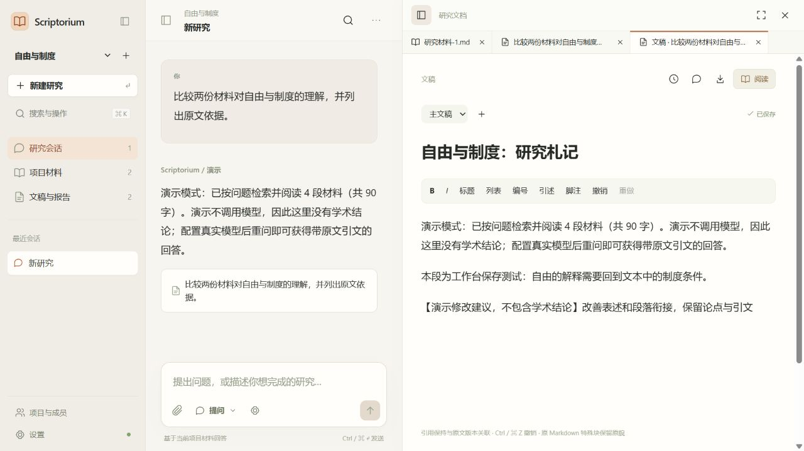
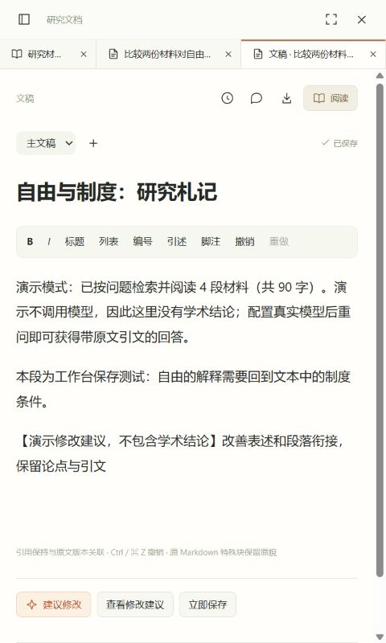
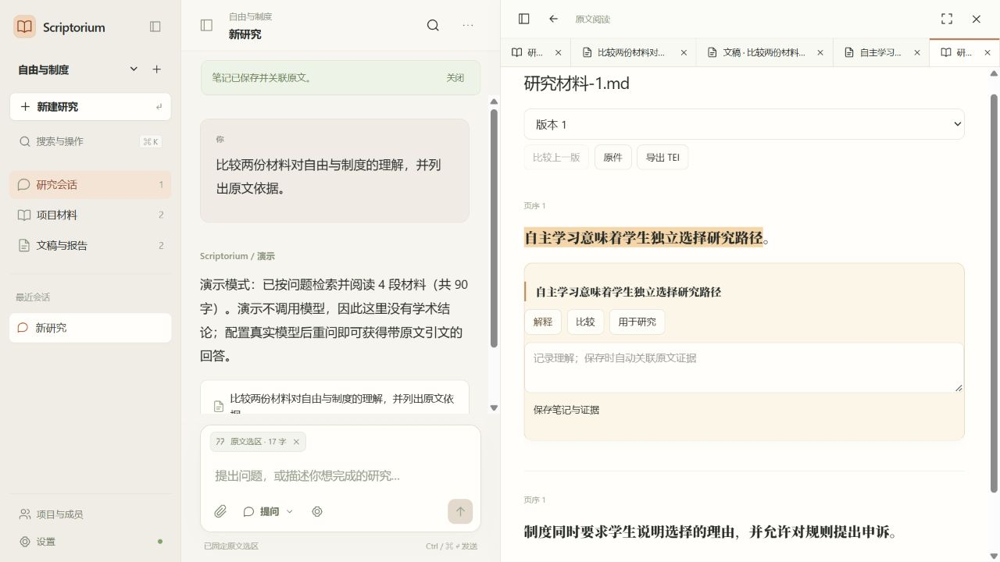

# Scriptorium 集成工作台验收记录 · 2026-10-25

## 结论

已交付工作台与后端的实质改造，必要定向检查通过，Windows NSIS 候选包生成成功。**完整计划尚未全部完成，不作为正式生产切换或“企业级全部验收通过”的声明。** 未完成项和未执行项见后文。

本轮取消 Agent 学术能力评分、专家评议、Qwen 八例重跑和大规模基准，不再等待学术能力验收。模型测试均使用明确的演示或模拟传输，付费调用为 0。没有提交、推送、发布、正式迁移、删除旧库或覆盖 README/tools 中原有工作。

## 已实现范围

| 范围 | 实现与实际行为 |
|---|---|
| 工作台 | 单一项目/会话导航、对话、文档框；可折叠导航、宽度调整、专注阅读、文档标签与返回；窄屏在对话与文档间切换 |
| 设计 | 新 workbench.css 分层规范；暖白、暖灰和橙色；Radix 弹层及命令面板、Motion 面板转场、安静模式与系统减少动态效果 |
| 状态 | 项目/用户/会话个人工作区，CAS 更新，编辑草稿及阅读位置；消息分页，编辑器/公式/图按需加载，局部错误边界 |
| 写作 | Tiptap JSON 编辑源，引用及脚注节点；章节编辑与历史；自动保存、冲突保留草稿、版本比较与恢复 |
| AI 建议 | 后台生成候选版本，查看前后内容与原因，接受/拒绝；接受前不改正式稿，过期修订拒绝写入 |
| 权限 | 负责人、研究者、评议者、只读成员；保护最后一名负责人；个人工作区不向其他成员泄露；撤权后重新检查访问 |
| 登录 | OIDC code + PKCE + nonce，RS256/ES256 签名与 issuer/audience 校验；服务器不保存 OIDC token；会话写入要求同源 Origin；服务商配置限制管理员 |
| 治理 | 外发服务商主机、材料、版本、累计预算政策与敏感材料限制；模型调用及项目变更审计；普通材料内容不能修改端点或政策 |
| 账本 | 研究、问答、访谈、旧分析与 Persona 的传输接入记账；Ollama 流与中断也登记；失败/未知用量不清零 |
| 导出 | 固定 Pandoc 3.12.1、散列校验、内置 CSL；异步 DOCX/Markdown/HTML，中文/英文脚注与作者年份；保留 JSON/TEI 档案导出 |
| 迁移与备份 | 后续 Alembic research_0005，不改历史迁移；新增表加入备份恢复，导出对象加入对象保留与备份 |
| 部署 | Windows 后台安装准备 Pandoc；Linux 新 compose.team.yml、Keycloak realm 与 HTTPS 代理配置；独立运行说明 |

主要代码：`scriptorium/research/{auth,governance,workbench_api,calls,editing,exporting,schema_v5}.py`、`migrations/research/versions/0005_workbench_governance.py`、`web/src/features/workspace/`。旧业务算法通过现有适配器继续运行，没有嵌回旧页面。

## 必要检查结果

| 检查 | 结果 | 证据 |
|---|---|---|
| Python 定向代码检查 | 通过 | output/integrated-python-lint.log；新增及受影响测试另经 Ruff 检查 |
| 前端代码检查 | 通过，无告警 | output/integrated-frontend-lint.log |
| TypeScript 与生产构建 | 通过 | output/integrated-frontend-build.log |
| OpenAPI 生成文件一致性 | 通过 | output/integrated-contract-check.log；v1 兼容路由仍有原有重复 Operation ID 告警 |
| 后端定向集成检查 | 23 个不同案例最终通过 | 见下方检查组合，失败与修正日志均保留 |
| 0004 → 0005 隔离升级 | 通过，既有测试记录保留 | output/integrated-migration-check.json |
| v5 逻辑备份恢复 | 通过 | test_new_tables_backup_restore 所属集成检查；实际恢复独立 schema |
| 真 Pandoc DOCX/HTML | 通过 | 核对 DOCX 脚注、书目、章节与英文 HTML 引用；非伪造导出文件 |
| 浏览器核心流程 | 通过 | 提问演示、报告、加入文稿、编辑/保存/刷新、建议/接受、DOCX；选区笔记及版本原文回跳 |
| 桌面与 480px 界面 | 冒烟通过 | evidence-20261025 截图；命令面板 Ctrl+K/Enter、Esc 焦点恢复及安静模式已操作 |
| Rust/Tauri/NSIS 构建 | 通过 | output/integrated-desktop-build.log |
| 打包后端 API/Worker | 通过 | output/integrated-packaged-smoke.json；独立库材料导入、DOCX 导出、静态资源 HTTP 200、0 模型调用 |
| Linux 配置语法 | 通过，非部署验收 | output/integrated-team-config-check.log；YAML 与 realm JSON/PKCE 检查 |

检查组合为 `test_integrated_workbench.py` 9 例、`test_research_experience.py` 6 例、`test_research_ask.py` 5 例，加旧工作台 Persona/理论兼容、访谈暂停恢复、研究取消与检查点恢复 3 例。未反复跑全量测试。

初次组合日志有 19 通过/1 失败：测试把无效版本应返回的 422 写成 404，已修正并单项复测通过。旧 Persona 模拟提供者原来绕过真实传输，无法进入新增账本，已改为模拟 HTTP 传输并复测通过；不是生产代码绕过记账。OIDC 登出响应调整后另作单项复测。日志分别为 integrated-backend-tests、integrated-targeted-retest、integrated-legacy-regression、integrated-persona-retest、integrated-oidc-retest。

浏览器发现并修复了编辑器销毁后访问 commands 的生命周期问题，以及独立设置弹层关闭后的焦点恢复。更新构建期间旧页面曾命中已替换的动态资源，刷新后加载最终构建；最终打包资源另经 HTTP 验证。

首次打包冒烟脚本误用 POST /materials 而返回 405；修正为 /imports 后在另一独立数据库复测通过，保留失败日志，不计首次尝试为通过。

PyInstaller 成功构建，但沿用 spec 中仍有 `scikit-learn` 这个非模块名隐藏导入告警；实际 sklearn 被标准 hook 收集。候选运行已验证导入和导出，没有把所有 Persona 数值流程的打包运行算作通过。

## 版本与候选文件

- Git 基点：`71324416677620885de334e3be7a070381dc00fc`，包含未提交修改。
- 构建输入代码摘要：`3a85aedc70662f4724819fcdbad225416b5760cc9ca6fcb25dcb79f3bd72ba66`（scripts/worktree-digest.py；不包含 docs/output/数据库和构建产物）。
- UI/安装包版本：3.1.1；研究服务 health 版本仍为 `4.0.0-dev`，正式发布前需统一发布标识。
- `src-tauri/target/release/bundle/nsis/Scriptorium Agent_3.1.1_x64-setup.exe`：130163377 bytes；SHA-256 `de89cc3e937773c87b3199c2f46a313e431094c316286a55f1d2682b3b15524b`。
- `src-tauri/bin/scriptorium-backend.exe`：127217344 bytes；SHA-256 `554446a6447f44fbecc341de9986b45d1928278447113acf5c913b88a5b120b4`。
- `src-tauri/target/release/scriptorium-desktop.exe`：13634048 bytes；SHA-256 `6611b1b06638b0ce38cb6c6d030cee212bbe31df57e21df8be0fe1a0803b40af`。

候选包未安装到用户当前正式目录。打包冒烟使用独立数据库 `scriptorium_packaged_smoke_20261025b`、独立对象目录和 8032 回环端口；测试后只停止了此次创建的 API/Worker。8031 浏览器预览也是合成材料库，不能作为已切换的正式研究库。

## 尚未完成的工程范围

1. **Linux 实机联调**：配置与 OIDC 模拟签名测试已具备，但真实 Keycloak/Caddy/PostgreSQL/ES 整套启动、证书、重启及组内登录尚未验证；当前机器没有 Docker。
2. **独立项目转移包**：当前已有整库备份/空库恢复及项目 JSON/TEI 导出，尚未实现带完整对象、成员重映射、来源散列和权限审查的单项目跨实例导入。整库备份含会话信息，不能冒充公开项目包。
3. **接口强类型完整覆盖**：已生成端点/请求模型并覆盖主要资源响应；部分旧业务仍返回 dict，尚未全部严格模型化。
4. **长原文性能**：消息分页和编辑器等按需加载已完成；原文当前按段落 DOM 呈现，尚未实现超长材料的完整窗口化渲染。
5. **流程细节**：预算与引文核验已有处理，其他改题/扩范围决定仍需继续细化不同按钮语义；章节排序、建议精细行级差异、批量材料导入队列及文稿脚注样式仍有改进空间。文档当前/固定版本标签的选中与标题刷新仍需细化。
6. **政策用途**：用途目前记录为审计说明；服务商/材料/版本/预算有强制检查，未提供按业务操作划分的用途授权矩阵。
7. **Windows 真实安装流程**：候选构建和候选后端启动已验证，但干净用户安装、登录自动恢复、升级失败回退及卸载没有本轮实机验收。不能宣称完整安装流程已通过。

## 跳过与未验证

- 按用户要求跳过：Agent 学术能力评分、专家复核、Qwen 八例、跨模型对比、消融、大规模语料基准、全量反复回归、并发压测、长期稳定性、正式安全认证、完整无障碍审计、多轮用户研究和干净环境矩阵。
- 本轮未执行：真实付费模型；S3/ES 全量集成重跑（本轮未改存储适配器）；真实中文输入法候选窗口自动化；真实团队 OIDC 服务；实际安装/卸载。
- 以上不计为通过。需要源库归属和授权确认的正式数据切换未执行，也不会随安装自动发生。

## 截图与说明

运行说明见 [集成运行手册](../integrated-workbench-runbook.md)，组件与视觉说明见 [设计记录](../integrated-workbench-design.md)。历史报告保留，不能将历史的全部通过记录累加为本轮验证结果。
