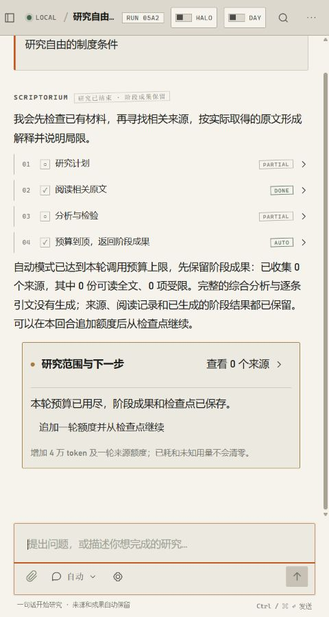
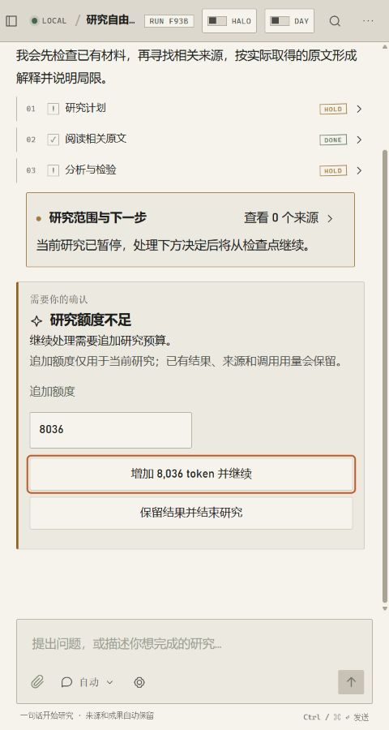
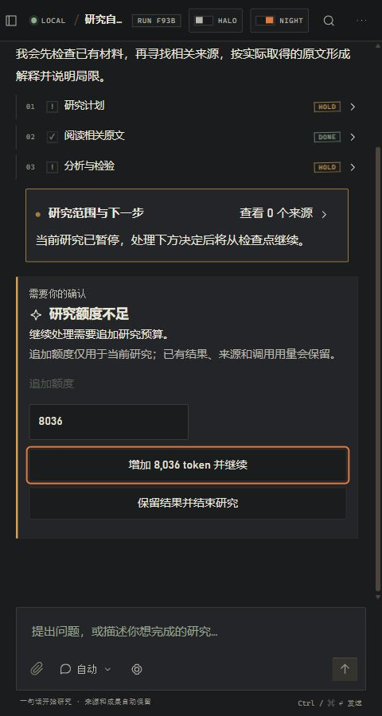
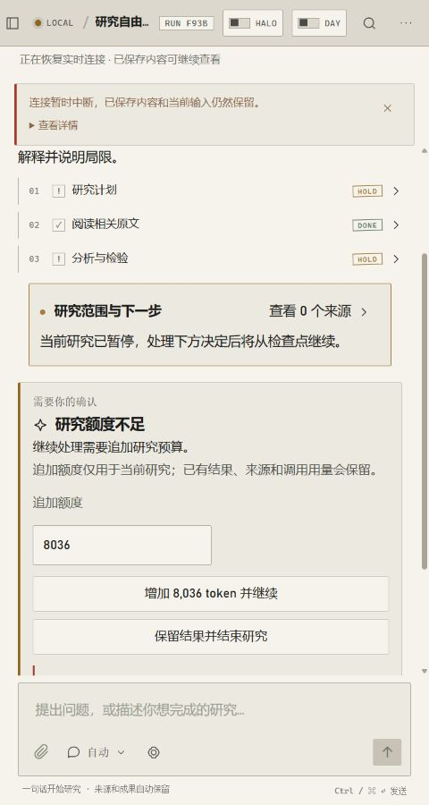

# 个人工作台修缮记录 · 2026-10-27

基线：`main` @ `74cd7e2`，本轮未提交工作树。依据剩余任务清单继续修复实际操作链；没有调用付费模型、迁移实际用户库、安装或重打安装包、提交推送。

## 修复内容

1. AUTO 在研究步骤预估预算不足或子任务拒绝预算时，也会结束为 `partial_completed`，不再落入逐步确认的预算决定。REVIEW 仍等待明确决定。
2. 阶段结束改为同一数据库事务提交研究运行、材料收集状态、消息、时间线与任务终态。删除吞掉数据库及执行权异常的 `except Exception`；失败会回滚，过期执行者仍不能提交。
3. 阶段成果卡增加“追加一轮额度并从检查点继续”，复用原任务、运行、内容块身份及已提交步骤。旧 revision 重放返回 409，不能重复追加额度；未消费的步骤及预算失败子任务可恢复。已耗用量与未知用量不清零。
4. 方法子任务明确继承 `review_mode`，防止逐步确认模式在调用记账处错误采用 AUTO 的预算规则。
5. 决定提交失败在当前卡片中显示 `role=alert`，保留输入和按钮；不再由全局操作包装器吞掉异常。补充只读提示、标题关联、处理中状态和窄屏按钮排版。
6. 项目选择器重选当前项目不再重新初始化会话。新决定消息关联原任务；旧待决消息根据决定关联去重，避免卡片下面重复追加状态说明。
7. 决定卡两处低对比文字改用语义正文颜色；弹层补充可见焦点。

## 必要检查

| 检查 | 结果 |
|---|---|
| 定向后端回归 | 39 passed，87.66 秒；覆盖 AUTO、时间线、预算生命周期、稳定写作 |
| 最后预算回归 | 4 passed；真实 PostgreSQL、真实 `run_one` Worker 执行链，演示提供者，无付费调用 |
| 前端单元 | 12 passed；时间线、保存队列、个人工作区相关用例 |
| 前端类型与生产构建 | 通过 |
| oxlint / ruff | 通过 |
| 480px 浏览器 | AUTO 阶段成果→追加额度→同回合完成报告；刷新保留草稿；项目重选保留输入；无横向溢出 |
| REVIEW 键盘 | 额度输入→接受→结束，焦点可见；项目弹层搜索与 Enter 选择可用 |
| 决定卡对比度 | 白班最小 7.25:1，夜班最小 7.57:1；只覆盖本轮卡片标题、说明与标签 |
| 断线负例 | 主动停止独立测试 API 后提交决定：原卡保留、就地提示失败，未显示成功 |

隔离数据库：`scriptorium_repair_preview_20261027`；测试集群端口 55435，预览 API 8042。新增集成测试逐例使用独立 schema。测试数据库、对象与证据保留；测试服务结束后停止，实际用户数据不变。

本轮验证包含显式演示结果，不将其表述为真实模型学术结论。“真实 Worker 链路”不等于真实模型调用或学术能力验证。

## 界面证据

机器记录：[浏览器检查](evidence-20261027-repair/browser-checks.json)、[后端回归](evidence-20261027-repair/repair-20261027-tests.log)、[最终预算检查](evidence-20261027-repair/repair-20261027-final-budget.log)、[前端测试](evidence-20261027-repair/repair-20261027-frontend-tests.log)、[构建](evidence-20261027-repair/repair-20261027-build.log)。

## 未执行与剩余事项

- 未执行全站对比度扫描、全站键盘审计和硬件输入法测试，不能将本轮局部通过升级为全站通过。
- 480px 的完整导入、选区批注及导出仍待专项浏览器回归；固定版本导出相关后端检查保留。
- 尚未完成全部 REVIEW 决策类型的抽屉重构；本轮保留会话内决定卡，先修正可恢复性与视觉可读性。
- 没有重跑付费 Qwen、学术评分、ES/S3、服务器部署、全量安装矩阵或全量测试；此前 427/2 为历史记录。
- 本轮未查询 GitHub CI。未生成包含此次改动的新安装包，旧 3.5.0 候选不能代表当前代码。

后续交付补记：用户随后明确授权打包和推送，已生成并核验 3.5.1，见 [3.5.1 打包记录](repair-3.5.1-package-20261027.md)。上面的“未打包”描述仅对应上一批修缮结束时的状态。
